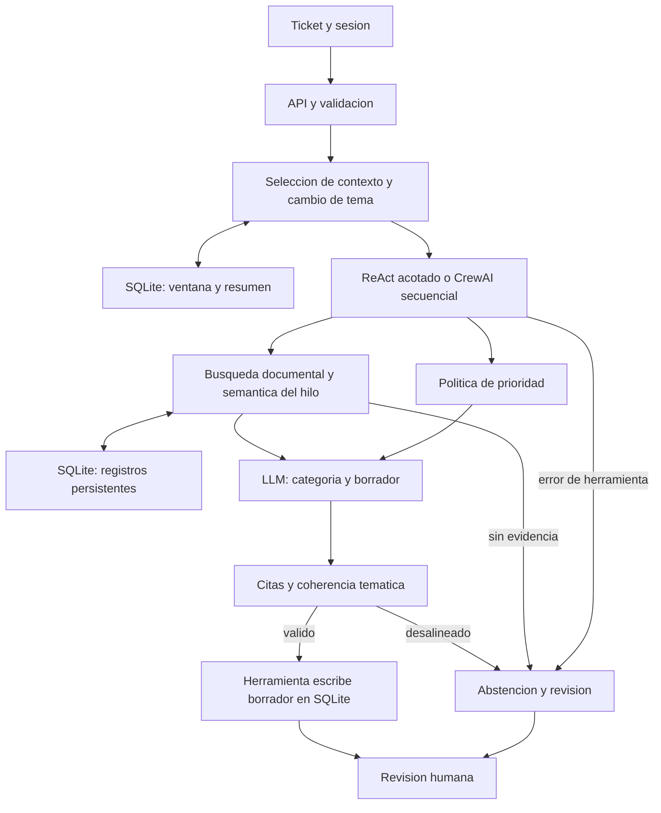

# CAT-IA · Soporte con evidencia

Asistente de soporte para **Nexo TI**, una organización ficticia. Clasifica solicitudes, recupera documentación interna y externa y prepara respuestas con citas para revisión humana. La Experiencia 2 incorpora memoria de conversación y coordinación de herramientas.

**Autoras:** Antonella Cuvertino y Miriam Hammami

**Docente:** Sebastián Ignacio Sánchez Morales

**Asignatura:** ISY0101 · Ingeniería de Soluciones con IA

**Estado:** prototipo académico local · EP2 revisada el 21/10/2026 según retroalimentación docente

## Revisión docente · EP2

Se añadieron control de cambio de tema, expansión de paráfrasis conocidas, validación temática de respuestas y citas, escritura de borradores en SQLite y recuperación semántica de entradas anteriores del mismo hilo. La presentación es **individual**: cada integrante practica el recorrido completo.

- [Guía de consultas y errores explicados](docs/13_prompts_demostracion.md).
- [24 preguntas y respuestas para la defensa](docs/14_preguntas_defensa.md).
- [Resultados de esta revisión](reports/FEEDBACK_RESULTADOS.md).
- [Decisiones de arquitectura y límites](docs/03_agentes_ea2.md).

Para EP2, descarga `ollama pull nomic-embed-text`, configura `CATIA_RETRIEVER=hybrid` y reinicia. En modo `lexical` no se realiza recuperación semántica del historial: es un baseline, no evidencia de IE4. `.env.example` conserva el modo de ensayo sin descargas obligatorias.



El modelo elige el orden inicial permitido y redacta. El código fija política, límites, selección de contexto y validación. La persona aprueba. En CrewAI los roles y sus herramientas están predefinidos. Los ADR del informe justifican LangChain Core 1.6.9, CrewAI 1.15.27, SQLite, Ollama, Qwen y nomic-embed-text con alternativas y referencias oficiales.

## Funcionalidades

- RAG sobre nueve documentos: siete internos simulados y dos síntesis de guías de Mozilla con procedencia registrada.
- Sesiones SQLite: tres intercambios recientes, resumen extractivo y hasta veinte registros con recuperación semántica por hilo y borrado desde la interfaz.
- Agente individual con ciclo ReAct acotado y herramientas tipadas de LangChain.
- Equipo CrewAI secuencial: Triage, Investigador RAG y Redactor.
- Prioridad por política, validación de citas, trazas de herramientas y revisión humana obligatoria.
- Ollama para inferencia local; simulador explícito para ensayar sin modelo.

## Inicio rápido · Windows

Requisito: Python 3.12. La instalación necesita internet.

```powershell
.\instalar.bat
.\instalar_ea2.bat
.\iniciar.bat
```

Abre **http://127.0.0.1:8000**. El segundo instalador añade CrewAI; la instalación base permite el modo individual. No se necesitan Node ni servicios de base de datos: SQLite viene con Python. La API se documenta en http://127.0.0.1:8000/docs mientras la app está encendida.

Para practicar: selecciona **Cobro duplicado**, analiza el caso, activa **Usar antecedentes** y pregunta «¿Qué debo hacer en ese caso?». Revisa memoria, herramientas y fuentes. Borra el hilo cuando cambies de caso. Lee el aviso que identifica simulación o LLM.

## Configurar Ollama

Instala [Ollama](https://ollama.com/download) y descarga el modelo:

```powershell
ollama pull qwen2.5:1.5b
```

El instalador prepara `.env` desde `.env.example` si no existe. Edita la configuración y reinicia la app:

```dotenv
CATIA_PROVIDER=ollama
OLLAMA_URL=http://127.0.0.1:11434
OLLAMA_MODEL=qwen2.5:1.5b
CATIA_ORCHESTRATION=react
CATIA_MEMORY_WINDOW=3
CATIA_RETRIEVER=lexical
```

En el computador original, `iniciar_modelo_local.bat` usa la instalación portable de `.tools/` en el puerto **11435**. Esa instalación y sus modelos no se incluyen en GitHub ni en el ZIP. En otro equipo utiliza la instalación estándar y el puerto correspondiente.

Para ensayar sin inferencia configura `CATIA_PROVIDER=demo`. El respaldo automático a demo está desactivado: solo se permite con la casilla explícita de la interfaz y se identifica en el resultado. La recuperación híbrida opcional requiere `nomic-embed-text` y `CATIA_RETRIEVER=hybrid`; sus métricas no deben confundirse con las del recuperador TF-IDF evaluado.

## Documentos para presentar EA2

| Archivo | Uso |
|---|---|
| [Presentación EP2](docs/presentacion_EA2_CAT-IA.pdf) | Diez diapositivas con orquestación y decisiones. |
| [Guion de Antonella y Miriam](deliverables/11_guion_clase_ea2.pdf) | Qué decir y cómo demostrar la app paso a paso. |
| [Dossier EA2](deliverables/dossier_EA2_CAT-IA.pdf) | Implementación, decisiones, guion y resultados consolidados. |
| [Arquitectura EA2](deliverables/arquitectura_EA2.pdf) | Componentes y flujo de la solución. |
| [Informe editable](docs/03_agentes_ea2.md) | Contratos, memoria, agentes, API y limitaciones. |
| [Resultados verificables](reports/FEEDBACK_RESULTADOS.md) | Evidencia de la revisión; los informes anteriores son históricos. |

Los Markdown son las fuentes editables de los PDF. EA1 se conserva en un [dossier consolidado](deliverables/dossier_completo_CAT-IA.pdf), su [presentación](deliverables/presentacion_CAT-IA.pdf) y su [arquitectura](deliverables/arquitectura_EA1.pdf). Sus secciones están en `docs/01`–`09`; describen la etapa anterior. Entrega EA1: 09/09/2026. Fecha de entrega EA2 por confirmar.

## Verificación y entrega

```powershell
# Software: no requiere Ollama; CrewAI se prueba si está instalado.
.\.venv\Scripts\python.exe -m pytest -q tests --junitxml=reports/tests_feedback.xml
# Cobertura separada: CrewAI se comprueba en la suite completa anterior.
.\.venv\Scripts\python.exe -m pytest -q tests -k "not test_crewai_executes_real_sequential_framework_in_demo" --cov=catia --cov-report=json:reports/coverage_feedback.json

# Integración real: requiere Ollama y el modelo configurado.
.\.venv\Scripts\python.exe -m scripts.evaluate_feedback
.\.venv\Scripts\python.exe -m scripts.smoke_ea2 --provider ollama --mode react --followup
.\.venv\Scripts\python.exe -m scripts.smoke_ea2 --provider ollama --mode crew

# Documentos y paquete de entrega.
.\.venv\Scripts\python.exe -m scripts.build_documents
.\.venv\Scripts\python.exe -m scripts.package
.\.venv\Scripts\python.exe -m scripts.check_package
```

`verificar.bat` reúne las pruebas de software, el ensayo simulado y la generación de PDF. El ZIP se crea en `dist/CAT-IA_entrega.zip`; no se versiona porque puede regenerarse. Su comprobación valida hashes y arranque desde una extracción con las dependencias del entorno actual.

La evidencia actual está en `reports/FEEDBACK_RESULTADOS.md` y `feedback_real.json`. Compara recuperación y reproduce P1–P3 del profesor. Los resultados del 11/10/2026 son históricos y corresponden a la versión anterior. No se atribuye la falla al tamaño del modelo ni se ha hecho una comparación entre tamaños. La latencia varía según equipo y carga.

## Organización del repositorio

| Carpeta | Contenido |
|---|---|
| `catia/` | API, contratos, recuperación, generación, memoria, herramientas y agentes. |
| `web/` | Interfaz HTML, CSS y JavaScript. |
| `data/`, `config/` | Corpus, manifiesto de fuentes y configuración RAG. |
| `prompts/` | Versiones v1–v3 de EA1 y v4 con continuidad para EA2. |
| `tests/`, `evaluation/` | Pruebas de software y casos de evaluación. |
| `reports/` | Evidencias identificadas por etapa, modelo y experimento. |
| `docs/`, `deliverables/` | Fuentes editables, diapositivas PDF en docs/ y guías/dossiers en deliverables/. |
| `scripts/` | Evaluación, verificación y generación reproducible de entregables. |

Se conservan los experimentos y prompts anteriores para comparar resultados. Se omiten PDF por capítulo que duplicaban los dossiers. `.env`, memoria, trazas locales, modelos, entorno virtual, cachés y ZIP generados quedan excluidos del repositorio.

## Alcance y límites

La memoria aporta antecedentes; no entrena el modelo ni convierte respuestas anteriores en evidencia. Las fuentes externas están incorporadas al corpus: no hay búsqueda web en vivo ni conexión a cuentas de Gmail o Microsoft. El sistema no envía respuestas a clientes.

La coincidencia de una cita no demuestra fidelidad semántica. La revisión humana de fidelidad y relevancia sigue pendiente. El prototipo funciona en loopback, sin autenticación empresarial, y debe usarse con datos ficticios. El resumen puede perder matices. Las métricas EA1 no se transfieren al prompt v4 ni garantizan desempeño organizacional o una calificación.
